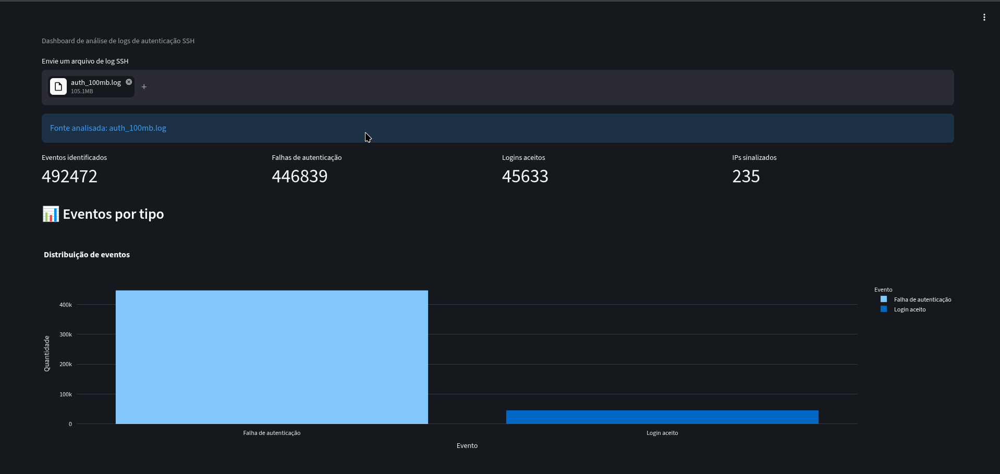

# 🛡️ LogSentinel

Dashboard de análise de logs de autenticação SSH desenvolvido
em Python para fins educacionais.



## Funcionalidades

- Identificação de falhas de autenticação e logins aceitos.
- Agrupamento de falhas por endereço IP.
- Alertas baseados em regras configuráveis.
- Gráficos interativos.
- Exportação dos eventos para CSV.
- Upload de arquivos de log.

## Tecnologias

- Python
- Streamlit
- Pandas
- Plotly
- Expressões regulares (Regex)

## Instalação

Clone o repositório e entre na pasta:

```bash
git clone https://github.com/Gustavo-de-Souza-Santos/LogSentinel.git
cd LogSentinel
```

Crie e ative um ambiente virtual:

```bash
python3 -m venv .venv
source .venv/bin/activate
```

Instale as dependências:

```bash
python -m pip install -r requirements.txt
```

Execute o dashboard:

```bash
streamlit run app.py
```

## Detecção

A versão inicial sinaliza IPs com três ou mais falhas
de autenticação no conjunto de logs analisado.

Esse limite é apenas uma regra didática. Um alerta não
confirma que houve um ataque.

## Aviso

Utilize arquivos de log que você tenha autorização para
analisar. Não publique registros com dados pessoais,
endereços internos ou informações confidenciais.

## Próximas melhorias
- Suporte a mais formatos de log.
- Histórico de eventos e filtros.
